# Technical Design: Replacing ASCII Reveal & ASCII Skeletons with Standard Pulse Skeletons

- **Author:** Elephant & Goldfish Planner (EGM)
- **Status:** Approved
- **Date:** 2026-11-11

---

## Overview

This document specifies the complete removal of the ASCII reveal and ASCII skeleton system
(`ascii-reveal`, canvas render loops, monospace glyph dithering, and `data-ascii` attributes) across
the AmsirarTrip codebase. It replaces them with standard, lightweight pulse skeletons based on
Tailwind CSS primitives and semantic HTML geometry, following modern UI component patterns (such as
shadcn-style `Skeleton`).

## The Problem

The codebase currently relies on `ascii-reveal` (a custom ASCII character dithering and canvas
reveal engine), `AsciiSkeleton.astro`, and `src/scripts/ascii-skeleton.ts`. This architecture
introduces several technical liabilities:

1. **Runtime & Memory Overhead**: `src/scripts/ascii-skeleton.ts` (550+ lines) registers global RAF
   loops, timer intervals, canvas memory allocations, and DOM query listeners across every route
   transition. On lower-end mobile devices, this causes main-thread contention and battery drain.
2. **Typography Coupling**: ASCII skeletons require fixed-pitch monospace fonts (`JetBrains Mono`,
   `ascii-reveal` font tables) to avoid glyph misalignments. This clashes visually with the brand's
   proportional typography and requires loading extra font files solely for loading states.
3. **Template Pollution**: Over 50 template files contain invasive `data-ascii` attributes and
   inline ASCII styling hooks that couple component markup to a specific decorative animation
   engine.
4. **Maintenance Fragility**: Any layout adjustment requires recalculating character cell widths,
   rows, dither seeds, and canvas bounding boxes in `AsciiSkeleton.astro`.
5. **Accessibility & Semantics**: Canvas-rendered ASCII blocks are opaque visual artifacts that do
   not convey structured skeleton relationships to assistive tech and fail basic semantic clarity.

Replacing this system with standard pulse skeletons (`animate-pulse`, `rounded-*`, standard
background tokens) removes runtime overhead, eliminates canvas leaks, respects user reduced-motion
preferences automatically via standard CSS, and drastically simplifies the component hierarchy.

## Goals

- Completely remove the `ascii-reveal` package dependency and eliminate
  `src/scripts/ascii-skeleton.ts`.
- Implement a clean `Skeleton` primitive component (`@/components/ui/skeleton` and
  `src/shared/ui/feedback/Skeleton.astro`) using Tailwind CSS `animate-pulse` and standard geometric
  utility classes.
- Refactor all 14 composite skeleton components (e.g., `TripCardSkeleton.astro`,
  `HomeHeroSkeleton.astro`, `PageHeaderSkeleton.astro`, `TourDetailSkeleton.astro`, etc.) to use the
  clean standard `Skeleton` primitive.
- Clean up all obsolete `data-ascii`, `data-ascii-reveal`, and ASCII CSS variables/classes in
  `src/styles/global.css`, `src/layouts/Layout.astro`, `src/scripts/transitions.ts`, and component
  templates.
- Retain smooth page transition feedback in `TransitionSkeletons.astro` using clean CSS opacity
  transitions.
- Ensure all TypeScript checks (`bun run check`), linters (`bun run lint`), and builds
  (`bun run build`) pass cleanly.

## Non-Goals

- Converting the project's Astro and Vue architecture to React. The standard shadcn skeleton design
  pattern demonstrated in the prompt will be implemented natively for Astro (`.astro`) and Vue
  (`.vue`) to preserve zero-JS hydration where appropriate.
- Redesigning page layout geometry or changing existing visual proportions of cards, headers, and
  grids.
- Altering Astro view transition navigation lifecycle or the progress bar in
  `src/scripts/transitions.ts` beyond removing ASCII reveal invocations.

## Open Questions

- **Component Format Strategy**: Should `Skeleton` be provided as an Astro component
  (`Skeleton.astro`), a Vue component (`Skeleton.vue`), or both, with a re-export path at
  `@/components/ui/skeleton`?
- **Dark Mode Tokens**: Should skeleton backgrounds use Tailwind semantic tokens
  (`bg-stone-200 dark:bg-stone-800` or a dedicated CSS variable `--skeleton-bg`) to remain
  consistent with theme switching?

## Critical User Journeys (CUJs)

### CUJ 1: Initial Page Load / Cold Navigation

- **Given**: A user navigates to `/tours` or `/` on a mobile or desktop browser.
- **When**: The page renders skeleton placeholders prior to asset completion or dynamic state.
- **Then**: Clean pulse boxes (`animate-pulse`) render instantly without loading monospace glyphs,
  allocating HTML canvases, or executing JavaScript loops.

### CUJ 2: Route Transition via Astro View Transitions

- **Given**: A user clicks an internal link (e.g. from `/` to `/about`).
- **When**: Astro client router prepares the new page and triggers the transition skeleton overlay
  in `TransitionSkeletons.astro`.
- **Then**: The skeleton overlay displays standard geometric pulse placeholders, transitions
  smoothly, and tears down cleanly without calling `ascii-reveal` or leaking canvas contexts.

### CUJ 3: Reduced Motion User Experience

- **Given**: A user has `prefers-reduced-motion: reduce` enabled on their operating system.
- **When**: Any skeleton placeholder is rendered.
- **Then**: The CSS `animate-pulse` animation is disabled via standard Tailwind
  `motion-reduce:animate-none`, presenting a static placeholder without flashing.

---

## Technical Plan (Architecture)

### 1. Architectural Strategy & Component Structure

The proposed architecture replaces a JavaScript-driven canvas animation engine with declarative,
zero-runtime CSS pulse components.

```mermaid
graph TD
    subgraph "Previous Architecture (Deprecated)"
        A1[Component Template] -->|data-ascii attributes| B1[ascii-skeleton.ts RAF Loop]
        B1 --> C1[Canvas Context & JetBrains Mono Fonts]
        C1 --> D1[Continuous Main-Thread ASCII Decode & Shimmer]
    end

    subgraph "New Architecture (Standard Pulse Skeletons)"
        A2[Component Template / Transition Overlay] --> B2["Skeleton.astro (@/components/ui/skeleton)"]
        B2 --> C2[Semantic HTML div + Tailwind animate-pulse]
        C2 --> D2[GPU-Accelerated CSS Transform / Opacity Fade]
    end
```



### 2. Primitive Component Specification

#### A. Astro Primitive: `src/components/ui/skeleton.astro` & `src/shared/ui/feedback/Skeleton.astro`

To fulfill the requested import path `import { Skeleton } from "@/components/ui/skeleton"` and
support idiomatic Astro components:

- `src/components/ui/skeleton.astro`: Primary Astro implementation.
- `src/components/ui/skeleton/index.ts`: TypeScript module providing typed re-exports:
  ```typescript
  import Skeleton from "./skeleton.astro";
  export { Skeleton };
  export default Skeleton;
  ```
- Component contract:
  ```astro
  ---
  import type { HTMLAttributes } from "astro/types";

  interface Props extends HTMLAttributes<"div"> {
    class?: string | undefined;
  }

  const { class: className, ...props } = Astro.props;
  ---

  <div
    aria-hidden="true"
    class:list={[
      "animate-pulse rounded-md bg-stone-200/80 dark:bg-stone-800/80 motion-reduce:animate-none",
      className,
    ]}
    {...props}
  />
  ```

#### B. Vue Primitive: `src/components/ui/skeleton/Skeleton.vue`

For interactive client islands (`BookingForm.vue`, `ContactForm.vue`, `Calendar.vue`):

- Accepts standard `class` attribute and arbitrary HTML attributes.
- Renders
  `<div :class="['animate-pulse rounded-md bg-stone-200/80 dark:bg-stone-800/80 motion-reduce:animate-none', $props.class]" />`.

### 3. Removal of ASCII Engine & Runtime Dependencies

1. **Delete Source Files**:
   - `src/scripts/ascii-skeleton.ts` (canvas dither shimmer loop).
   - `src/shared/ui/feedback/AsciiSkeleton.astro` (monospace ASCII generator).
2. **Package De-registration**:
   - Uninstall/remove `"ascii-reveal": "^0.3.0"` from `package.json`.
   - Remove `ascii-reveal/core` ambient module declaration in `src/env.d.ts`.
3. **Transition Script Simplification (`src/scripts/transitions.ts`)**:
   - Remove imports: `cleanupAsciiReveals`, `initAsciiSkeletons`, `triggerPageReveal`.
   - Remove lifecycle invocation hooks in `astro:before-preparation`, `astro:after-swap`, and
     `astro:page-load`.
   - Retain progress bar and transition timing without ASCII canvas delays.
4. **Layout Cleanup (`src/layouts/Layout.astro`)**:
   - Remove `<script src="../scripts/ascii-skeleton.ts"></script>`.
5. **Stylesheet Purge (`src/styles/global.css`)**:
   - Remove custom properties: `--ascii-font`, `--ascii-skeleton`, `--ascii-accent`,
     `--ascii-glyph`, `--ascii-surface`, `--ars-wave-color`, `--ars-radius`.
   - Remove Section 6.6 (`ASCII reveal engine`) and Section 6.7 (`ASCII skeleton` `.ars`,
     `.ars-image`, etc.).
   - Remove Section 8 unlayered overrides dedicated to ASCII reveal.

### 4. Refactoring Composite Skeletons

All 14 composite skeleton components will be refactored to compose the new `Skeleton` primitive:

| Component Path                                                   | Previous Implementation                      | Refactored Architecture                                                   |
| :--------------------------------------------------------------- | :------------------------------------------- | :------------------------------------------------------------------------ |
| `src/shared/ui/feedback/TripCardSkeleton.astro`                  | `AsciiSkeleton` canvas rows + mono widths    | Rounded `Skeleton` aspect-ratio container + text pulse bars               |
| `src/shared/ui/feedback/TourDetailSkeleton.astro`                | Monospace glyph lines & canvas dither        | Structured flex/grid pulse layout mirroring itinerary & pricing           |
| `src/shared/ui/feedback/HomeHeroSkeleton.astro`                  | `AsciiSkeleton` hero backdrop & title        | High-contrast geometric header skeletons with responsive heights          |
| `src/shared/ui/feedback/AboutSkeleton.astro`                     | Multi-line ASCII dither text                 | Semantic paragraph blocks with varied widths (`w-full`, `w-4/5`, `w-2/3`) |
| `src/shared/ui/feedback/ContactSkeleton.astro`                   | Monospace input placeholders                 | Form input pulse blocks matching field height (`h-11`)                    |
| `src/shared/ui/feedback/FaqSkeleton.astro`                       | ASCII question & answer rows                 | Accordion pulse trigger rows with chevron placeholder                     |
| `src/shared/ui/feedback/PageHeaderSkeleton.astro`                | Monospace breadcrumbs & headers              | Breadcrumb pill skeletons + heading pulse bars                            |
| `src/shared/ui/feedback/ButtonSkeleton.astro`                    | `AsciiSkeleton` button shape                 | Pill or rounded button placeholder (`rounded-xl h-10 w-28`)               |
| `src/features/home/components/FeaturedToursSkeleton.astro`       | Grid of ASCII trip cards                     | Grid of refactored `TripCardSkeleton` components                          |
| `src/features/home/components/HomeStatsSkeleton.astro`           | Monospace numeric blocks                     | Stat metric card skeletons with number and label pulse bars               |
| `src/features/home/components/ServicesSectionSkeleton.astro`     | ASCII service blocks                         | Service card grid skeletons with icon & text placeholders                 |
| `src/features/home/components/TestimonialsSectionSkeleton.astro` | Monospace quote blocks                       | Testimonial avatar + quote skeleton cards                                 |
| `src/features/home/components/VideoSectionSkeleton.astro`        | ASCII video aspect canvas                    | Aspect-video pulse card with center play button placeholder               |
| `src/layouts/components/TransitionSkeletons.astro`               | Overlay container embedding ASCII components | Overlay container embedding clean pulse components                        |

### 5. Template Attribute Cleanup (`data-ascii`)

All decorative `data-ascii` and `data-ascii-reveal` attributes scattered across 50+ templates
(`Navbar.astro`, `Button.astro`, `PricingCard.astro`, `TripCard.astro`, `AboutView.astro`,
`BookingForm.vue`, etc.) will be stripped cleanly. Elements will rely on standard CSS transitions or
instant render without intermediate character decoding.

---

## Alternatives Considered

### Alternative A: Pure-CSS Monospace ASCII Shimmer (No Canvas)

- **Description**: Eliminate the canvas animation loop in `ascii-skeleton.ts`, but keep ASCII glyphs
  (`░▒▓█`) rendered as raw text styled with a CSS background-clip shimmer gradient.
- **Pros**: Removes the JavaScript RAF loop and canvas context allocation overhead.
- **Cons**: Still requires bundling and downloading `JetBrains Mono` monospace fonts solely for
  placeholder states. Fixed-width glyph lines cause visual jaggedness and layout mismatch with
  proportional heading and body fonts.
- **Reason for Rejection**: Directly contradicts the user's requirement for normal geometric
  skeletons and preserves unnecessary font assets.

### Alternative B: Adopting React Runtime for Exact shadcn/ui Implementation

- **Description**: Install `@astrojs/react`, `react`, and `react-dom` to use shadcn/ui React
  components directly.
- **Pros**: Direct verbatim compatibility with React code snippets from shadcn documentation.
- **Cons**: Adds substantial dependency bloat (React + ReactDOM + Astro React adapter) to a codebase
  already standardized on Astro and Vue. Increases client bundle weight and creates confusing
  multi-framework island fragmentation.
- **Reason for Rejection**: Unjustified architectural complexity and performance regression. Native
  Astro and Vue implementations fulfill the exact visual and API contracts with zero runtime
  overhead.

### Alternative C: Directional SVG Gradient Shimmer Sweep

- **Description**: Implement a moving linear gradient sweep
  (`bg-gradient-to-r from-stone-200 via-stone-100 to-stone-200`) using custom CSS keyframes instead
  of `animate-pulse`.
- **Pros**: Mimics certain platform-specific skeleton sweep animations.
- **Cons**: Requires custom keyframe definitions, increases stylesheet footprint, and requires
  explicit manual configuration for dark mode and reduced-motion states.
- **Reason for Rejection**: Tailwind's built-in `animate-pulse` is the industry standard for
  shadcn-style skeletons, compiles down to native CSS, and seamlessly integrates with
  `motion-reduce:animate-none`.

---

## Detailed Implementation Plan

### 1. Target Files to Create

#### `src/components/ui/skeleton/skeleton.astro` & `src/components/ui/skeleton.astro` (Create)

- **Scope**: Primary Astro UI Primitive.
- **Proposed API**:
  - Accepts standard HTML `div` attributes including `class` and `style`.
  - Applies base classes:
    `animate-pulse rounded-md bg-stone-200/80 dark:bg-stone-800/80 motion-reduce:animate-none`.
  - Sets `aria-hidden="true"` by default.

#### `src/components/ui/skeleton/index.ts` (Create)

- **Scope**: Module Re-export.
- **Proposed API**:
  - Re-exports `Skeleton` from `./skeleton.astro` (both named and default export) so that
    `import { Skeleton } from "@/components/ui/skeleton"` works out of the box in `.astro` files and
    TypeScript modules.

#### `src/components/ui/skeleton/Skeleton.vue` (Create)

- **Scope**: Client Island Vue UI Primitive.
- **Proposed API**:
  - Vue 3 component implementing the same pulse styling and accessibility contract for interactive
    form islands.

#### `src/shared/ui/feedback/Skeleton.astro` (Create)

- **Scope**: Architecture Bridge.
- **Proposed API**:
  - Direct re-export of `src/components/ui/skeleton/skeleton.astro` maintaining consistency with
    existing `src/shared/ui/feedback/` conventions.

---

### 2. Target Files to Delete

#### `src/scripts/ascii-skeleton.ts` (Delete)

- **Rationale**: Eliminates the 554-line RAF canvas animation loop, shimmer timers, character sets,
  and DOM event listeners.

#### `src/shared/ui/feedback/AsciiSkeleton.astro` (Delete)

- **Rationale**: Eliminates the legacy ASCII skeleton generator component.

---

### 3. Target Files to Modify

#### `package.json` (Modify)

- **Changes**: Remove `"ascii-reveal": "^0.3.0"` from dependencies. Run `bun install` to synchronize
  `bun.lock`.

#### `src/env.d.ts` (Modify)

- **Changes**: Remove `declare module "ascii-reveal/core";`.

#### `src/layouts/Layout.astro` (Modify)

- **Changes**:
  - Remove `<script src="../scripts/ascii-skeleton.ts"></script>`.
  - Remove `data-ascii="skip"` on WhatsApp widget anchor.

#### `src/scripts/transitions.ts` (Modify)

- **Changes**:
  - Remove imports of `cleanupAsciiReveals`, `initAsciiSkeletons`, and `triggerPageReveal`.
  - Remove ASCII reveal calls from transition lifecycle listeners (`astro:before-preparation`,
    `astro:after-swap`, `astro:page-load`).

#### `src/styles/global.css` (Modify)

- **Changes**:
  - Remove `--ascii-*` and `--ars-*` variables from `:root` and `.dark`.
  - Delete Section 6.6 (`ASCII reveal engine`) and Section 6.7 (`ASCII skeleton`).
  - Delete Section 8 unlayered overrides for ASCII reveal.

#### Composite Skeletons (`src/shared/ui/feedback/` & `src/features/home/components/`) (Modify)

- **Files**:
  - `src/shared/ui/feedback/TripCardSkeleton.astro`
  - `src/shared/ui/feedback/TourDetailSkeleton.astro`
  - `src/shared/ui/feedback/HomeHeroSkeleton.astro`
  - `src/shared/ui/feedback/AboutSkeleton.astro`
  - `src/shared/ui/feedback/ContactSkeleton.astro`
  - `src/shared/ui/feedback/FaqSkeleton.astro`
  - `src/shared/ui/feedback/PageHeaderSkeleton.astro`
  - `src/shared/ui/feedback/ButtonSkeleton.astro`
  - `src/features/home/components/FeaturedToursSkeleton.astro`
  - `src/features/home/components/HomeStatsSkeleton.astro`
  - `src/features/home/components/ServicesSectionSkeleton.astro`
  - `src/features/home/components/TestimonialsSectionSkeleton.astro`
  - `src/features/home/components/VideoSectionSkeleton.astro`
  - `src/layouts/components/TransitionSkeletons.astro`
- **Changes**: Replace all `AsciiSkeleton` imports and markup with `Skeleton` from
  `@/components/ui/skeleton`. Transform complex rows/widths specs into standard layout classes
  (`h-4 w-3/4`, `aspect-golden`, `rounded-full`, etc.).

#### Template Markup Cleanup: Remove `data-ascii` Attributes (Modify)

- **Files**:
  - `src/shared/ui/primitives/Button.astro`
  - `src/shared/ui/widgets/PricingCard.astro`
  - `src/shared/ui/widgets/TripCard.astro`
  - `src/shared/ui/widgets/FaqAccordion.astro`
  - `src/shared/ui/widgets/HighlightsList.astro`
  - `src/shared/ui/widgets/RouteMapCard.astro`
  - `src/shared/ui/widgets/StatHighlights.astro`
  - `src/shared/ui/widgets/TripInfoSections.astro`
  - `src/shared/ui/widgets/CookieConsent.astro`
  - `src/layouts/Navbar.astro`
  - `src/layouts/PageHeader.astro`
  - `src/layouts/DetailsSidebar.astro`
  - `src/layouts/TripLayout.astro`
  - `src/features/about/components/AboutView.astro`
  - `src/features/booking/components/BookingForm.vue`
  - `src/features/booking/components/BookingSidebar.astro`
  - `src/features/contact/components/ContactFolderStack.astro`
  - `src/features/contact/components/ContactForm.vue`
  - `src/features/contact/components/ContactView.astro`
  - `src/features/excursions/components/ExcursionProgram.astro`
  - `src/features/excursions/components/ExcursionSeoSections.astro`
  - `src/features/excursions/components/ExcursionsView.astro`
  - `src/features/home/components/FeaturedTours.astro`
  - `src/features/home/components/HomeHero.astro`
  - `src/features/home/components/HomeStats.astro`
  - `src/features/home/components/ServicesScrollStack.astro`
  - `src/features/home/components/ServicesSection.astro`
  - `src/features/home/components/SliderCards.astro`
  - `src/features/home/components/StatsFolderStack.astro`
  - `src/features/home/components/TestimonialsScrollStack.astro`
  - `src/features/home/components/TestimonialsSideScroll.astro`
  - `src/features/legal/components/PrivacyView.astro`
  - `src/features/legal/components/TermsView.astro`
  - `src/features/tours/components/TourItinerary.astro`
  - `src/features/tours/components/TourSeoSections.astro`
  - `src/features/tours/components/ToursView.astro`
- **Changes**: Strip all obsolete `data-ascii="reveal"`, `data-ascii="fade"`, `data-ascii="slide"`,
  and `data-ascii="skip"` attributes.

---

### 4. Verification Plan

- **Dependency Cleanup**: Run `bun install` and confirm `ascii-reveal` is removed from
  `node_modules` and `bun.lock`.
- **TypeScript & Type Checking**: Run `bun run check`
  (`bun scripts/i18n-check.ts && astro check && tsc --noEmit`) to verify zero broken imports or type
  mismatches.
- **Linting & Code Style**: Run `bun run lint` (`eslint . && bun run lint:style`) and
  `bun run format:check` to verify code quality and CSS conformance.
- **Production Build**: Run `bun run build` to ensure static page generation, SSR endpoints, and
  asset bundling complete with zero errors.

---

_Drafted with EGM_
