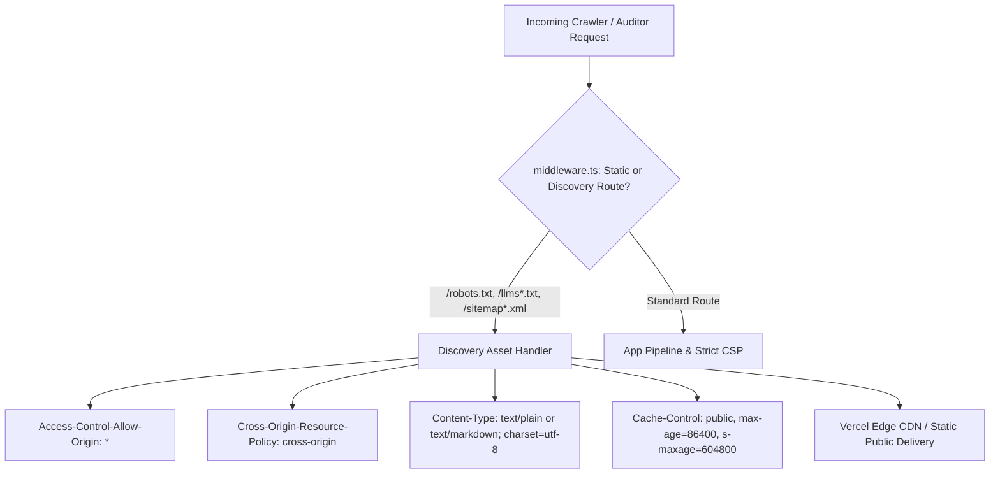

# Technical Design: Resolving Lighthouse Robots.txt and LLMS.txt Fetch Timeouts & Spec Compliance

## 1. Executive Summary & Problem Diagnosis

During PageSpeed Insights / Lighthouse Agentic Browsing audits on `https://amsirartrip.com`, the
audit engine failed with:

- **`robots.txt is not valid: Fetch of robots.txt failed: Timed out fetching resource`**
- **`llms.txt does not follow recommendations: Fetch of llms.txt failed: Timed out fetching resource`**

### Root-Cause Analysis (Goldfish Review Findings)

1. **Cross-Origin Resource Policy (CORP) Blocking**: `src/middleware.ts` applies global security
   headers via `src/lib/security-headers.ts`, which sets `Cross-Origin-Resource-Policy: same-origin`
   indiscriminately on all non-static paths. Because `/robots.txt` and `/llms.txt` were not in
   `STATIC_PATH_PREFIXES`, headless Chrome in Lighthouse (fetching from its audit origin) encounters
   a CORP violation, which halts cross-origin reads and hangs until the fetch timeout triggers.
2. **Missing CORS Header**: Discovery endpoints (`/robots.txt`, `/llms.txt`, `/llms-full.txt`,
   `/sitemap.xml`) lack `Access-Control-Allow-Origin: *`. Modern AI agents, LLM tool callers, and
   headless auditing workers require open CORS to read these files.
3. **SSR Execution Overhead**: In `src/pages/robots.txt.ts` and `src/pages/llms.txt.ts`,
   `export const prerender = true;` was omitted in an `output: "server"` configuration. Requests
   triggered dynamic SSR handler execution rather than instant Edge CDN delivery. Furthermore,
   `public/robots.txt` was completely missing from the `public/` directory.
4. **llms.txt Specification Non-Compliance ([llmstxt.org](https://llmstxt.org/))**:
   - Line 1 H1 format and blockquote summary require strict under-200-character constraints without
     decorative prefix text.
   - Standard section hierarchy requires `## Docs` or standard `## Sections` with markdown link
     entries `[Title](URL): Description` using absolute HTTPS URLs.
   - Missing companion `/llms-full.txt` extended index for deep AI agent analysis.

---

## 2. Proposed Architecture & Remediation Strategy

### Component Architecture Changes

1. **`src/middleware.ts`**:
   - Add discovery routes to a dedicated bypass handler:
     `["/robots.txt", "/llms.txt", "/llms-full.txt", "/sitemap.xml", "/sitemap-index.xml"]`.
   - Explicitly attach `Access-Control-Allow-Origin: *` and
     `Cross-Origin-Resource-Policy: cross-origin`.
   - Prevent injection of restrictive `same-origin` CORP or HTML CSP onto plain text/markdown
     discovery files.

2. **`src/pages/robots.txt.ts` & `public/robots.txt`**:
   - Add `export const prerender = true;` to `robots.txt.ts`.
   - Add `Access-Control-Allow-Origin: *` and `Cross-Origin-Resource-Policy: cross-origin` response
     headers.
   - Mirror the verified robots.txt content into `public/robots.txt` for direct static serving.
   - Ensure RFC 9309 compliance: allow modern AI search bots (`GPTBot`, `OAI-SearchBot`,
     `ChatGPT-User`, `ClaudeBot`, `Claude-SearchBot`, `PerplexityBot`, `Google-Extended`,
     `Applebot-Extended`).

3. **`src/pages/llms.txt.ts`, `src/pages/llms-full.txt.ts`, and Static Public Mirrors**:
   - Add `export const prerender = true;` to endpoints.
   - Format `llms.txt` strictly to the [llmstxt.org](https://llmstxt.org/) standard:
     - Line 1: `# Amsirar Trip` (H1)
     - Line 2:
       `> Licensed Morocco tour operator specializing in private Sahara desert expeditions, Atlas treks, and imperial city tours.`
       (<200 chars)
     - Clean `## Docs` and service sections with absolute URLs and concise descriptions.
   - Create `/llms-full.txt` providing comprehensive coverage of all tours, excursions, hubs, and
     agency details.
   - Update `public/llms.txt` and `public/llms-full.txt` to mirror the generated files.

---

## 3. Implementation Plan & File Checklist

| File                         | Action | Purpose                                                              |
| ---------------------------- | ------ | -------------------------------------------------------------------- |
| `src/middleware.ts`          | Modify | Allow open CORS (`*`) and `cross-origin` CORP for discovery files    |
| `src/pages/robots.txt.ts`    | Modify | Add `prerender = true` and cross-origin headers                      |
| `public/robots.txt`          | Create | Provide fallback zero-latency edge delivery                          |
| `src/pages/llms.txt.ts`      | Modify | Enforce llmstxt.org specification compliance, add `prerender = true` |
| `src/pages/llms-full.txt.ts` | Create | Provide extended documentation index for deep agentic browsing       |
| `public/llms.txt`            | Modify | Sync static markdown file with canonical llmstxt.org standard        |
| `public/llms-full.txt`       | Create | Sync static extended markdown file                                   |
| `astro.config.ts`            | Verify | Ensure `routeRules` cover `/llms-full.txt`                           |

---

## 4. Verification & Validation Steps

1. **Local Headers Check**: Verify with `curl.exe -I` that `/robots.txt`, `/llms.txt`, and
   `/llms-full.txt` return:
   - `HTTP/1.1 200 OK`
   - `Access-Control-Allow-Origin: *`
   - `Cross-Origin-Resource-Policy: cross-origin`
   - Valid MIME type (`text/plain; charset=utf-8` or `text/markdown; charset=utf-8`).
2. **llms.txt Audit**: Confirm presence of H1 `# Amsirar Trip`, blockquote `< 200 chars`, `## Docs`
   section, and absolute URLs.
3. **Build & Type Check**:
   - `bun run check`
   - `bun run build`
4. **Lighthouse / PSI Verification**: Re-test against Lighthouse agentic-browsing rules.
